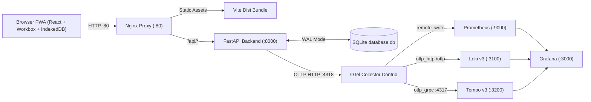

# Money Tracker PWA — Documentation

> [!NOTE]
> Prefer reading in a styled documentation web app? View the static site published from this directory at:
> **https://anuragdchowdhury.github.io/expense-tracker-PWA-LGTM-stack/** (or open [`index.html`](./index.html) locally).

Welcome to the Markdown documentation for **Money Tracker PWA & LGTM Observability Stack** — an offline-first personal expense and monthly budget tracker built with **React 18 + Vite PWA**, **Python 3.11 + FastAPI + SQLite (WAL mode)**, defaulted to **INR (`₹`)**, and instrumented end-to-end with **OpenTelemetry + Grafana LGTM** (`Loki`, `Grafana`, `Tempo`, `Prometheus`).

## Documentation Index

| Document | Audience & Focus | GitHub Pages View |
| :--- | :--- | :--- |
| **[Tech Stack & Overview](./tech-stack.md)** | Frontend, backend, Nginx, OTel/LGTM versions, repo structure, GitHub Pages setup | [`index.html`](./index.html) |
| **[High-Level Design (HLD)](./hld.md)** | 7-container topology, Docker bridge & volumes, offline-first `client_id` sync, Nginx caching | [`hld.html`](./hld.html) |
| **[Low-Level Design (LLD)](./lld.md)** | SQLite ER schema & pragmas, FastAPI contracts, trend aggregations, client modules (`currency.js`, `temporal.js`) | [`lld.html`](./lld.html) |
| **[Observability & LGTM Setup](./observability.md)** | OTel Python instrumentation, Collector pipelines, Prometheus v3, Loki v3 TSDB, Tempo v3, Grafana correlation | [`observability.html`](./observability.html) |

## Quick Architecture Summary



## Quick Commands

```zsh
# Start full 7-container application + LGTM stack
docker compose up --build -d

# Check container status & API health
docker compose ps
curl -fsS http://localhost:80/api/health
curl -fsS "http://localhost:80/api/dashboard?year=2026&month=11"

# Stop containers (preserving database & observability volumes)
docker compose down
```

- **App & PWA:** `http://localhost:80`
- **Grafana UI:** `http://localhost:3000` (`admin` / `admin`, anonymous Admin enabled locally)

← Back to [Repository README](../README.md)

