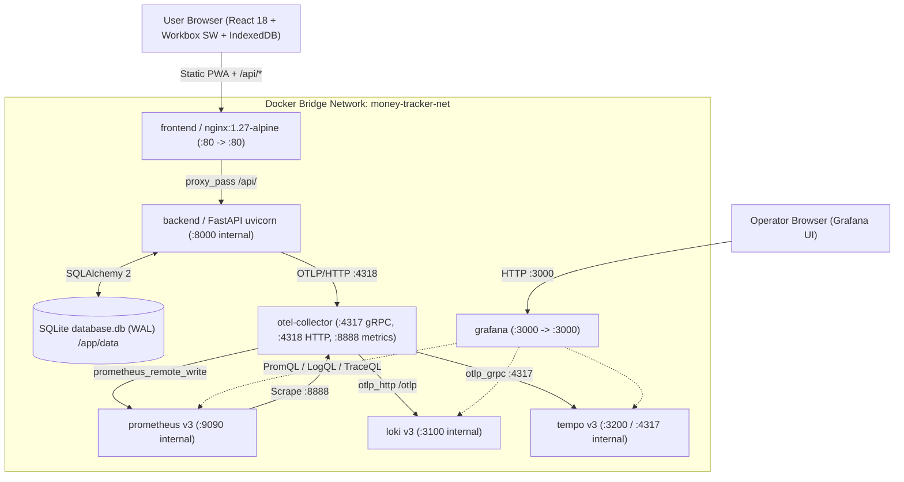
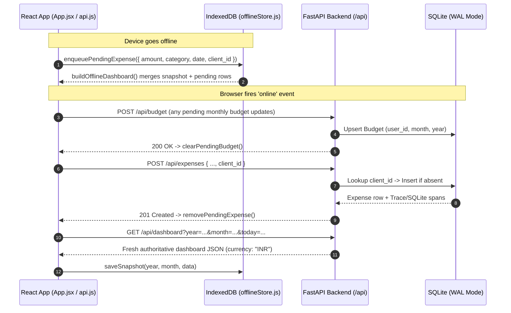

# High-Level Design (HLD)

> Reading on GitHub Pages? Open [`hld.html`](./hld.html) • Back to [Docs Home](./README.md)

## 1. System Context & Container Topology

The platform separates user-facing ledger transactions from observability fan-out so monitoring backends never block application request latency. All containers communicate over an isolated Docker bridge network (`money-tracker-net`) using service names as DNS hostnames.

---

## 2. Docker Network & Persistent Volumes

Only two ports are bound to the host interface (`APP_PORT=80` for the app gateway and `GRAFANA_PORT=3000` for Grafana). All storage and internal telemetry endpoints stay private inside `money-tracker-net`.

Defined in [`docker-compose.yml`](../docker-compose.yml):

| Volume / Network | Mounted Container & Path | Stored State |
| :--- | :--- | :--- |
| `backend-data` | `money-tracker-backend` → `/app/data` | `database.db`, `-wal`, and `-shm` SQLite ledger files |
| `prometheus-data` | `money-tracker-prometheus` → `/prometheus` | TSDB metric blocks & remote-write time series |
| `loki-data` | `money-tracker-loki` → `/loki` | Log chunks, TSDB v13 index, retention compactor working files |
| `tempo-data` | `money-tracker-tempo` → `/var/tempo` | Trace WAL and monolithic local trace blocks |
| `grafana-data` | `money-tracker-grafana` → `/var/lib/grafana` | Grafana state DB (`provisioning/` is mounted read-only) |
| `money-tracker-net` | Bridge network across all 7 services | Isolated internal container DNS (`backend`, `otel-collector`, `prometheus`, `loki`, `tempo`) |

---

## 3. Offline-First PWA & Idempotent `client_id` Sync Flow

When offline (`navigator.onLine === false` or network failure), [`api.js`](../frontend/src/api.js) and [`offlineStore.js`](../frontend/src/utils/offlineStore.js) persist pending changes in IndexedDB (`money-tracker-pwa` DB, store `kv`) and recompute category shares, daily cumulative spend, and weekly trends locally via `buildOfflineDashboard()`.

Every offline expense is tagged with a client-generated UUID (`client_id`). When connectivity returns (`window` `online` event or manual **Sync Now**), `syncPendingChanges()` replays budgets first and then expenses. Because SQLite enforces `UNIQUE(client_id)` on `expenses`, retries are idempotent and never create duplicate records.

---

## 4. Nginx Reverse Proxy & PWA Caching Strategy

Configured in [`nginx/default.conf`](../nginx/default.conf). Proper cache separation prevents clients from getting stuck on an old Workbox service worker or stale `index.html`:

| Location Block | Cache / Proxy Policy | Purpose |
| :--- | :--- | :--- |
| `= /index.html` | `Cache-Control: no-cache, no-store, must-revalidate` | Guarantees browsers always fetch current hashed bundle URLs |
| `sw.js`, `manifest.json`, `workbox-*.js` | `Cache-Control: no-cache, no-store, must-revalidate` | Lets Workbox `registerType: 'autoUpdate'` detect new service workers immediately |
| `/assets/` | `Cache-Control: public, max-age=31536000, immutable` | Long-term immutable caching for content-hashed Vite JS/CSS chunks |
| `/api/` | `proxy_pass http://backend:8000;` | Same-origin reverse proxy (zero CORS overhead, 5s connect / 30s read timeouts) |
| `/` (SPA fallback) | `try_files $uri $uri/ /index.html;` | Serves SPA cleanly on client reloads without Nginx 404s |

← Previous: [Tech Stack](./tech-stack.md) | Next: [Low-Level Design (LLD) →](./lld.md)

