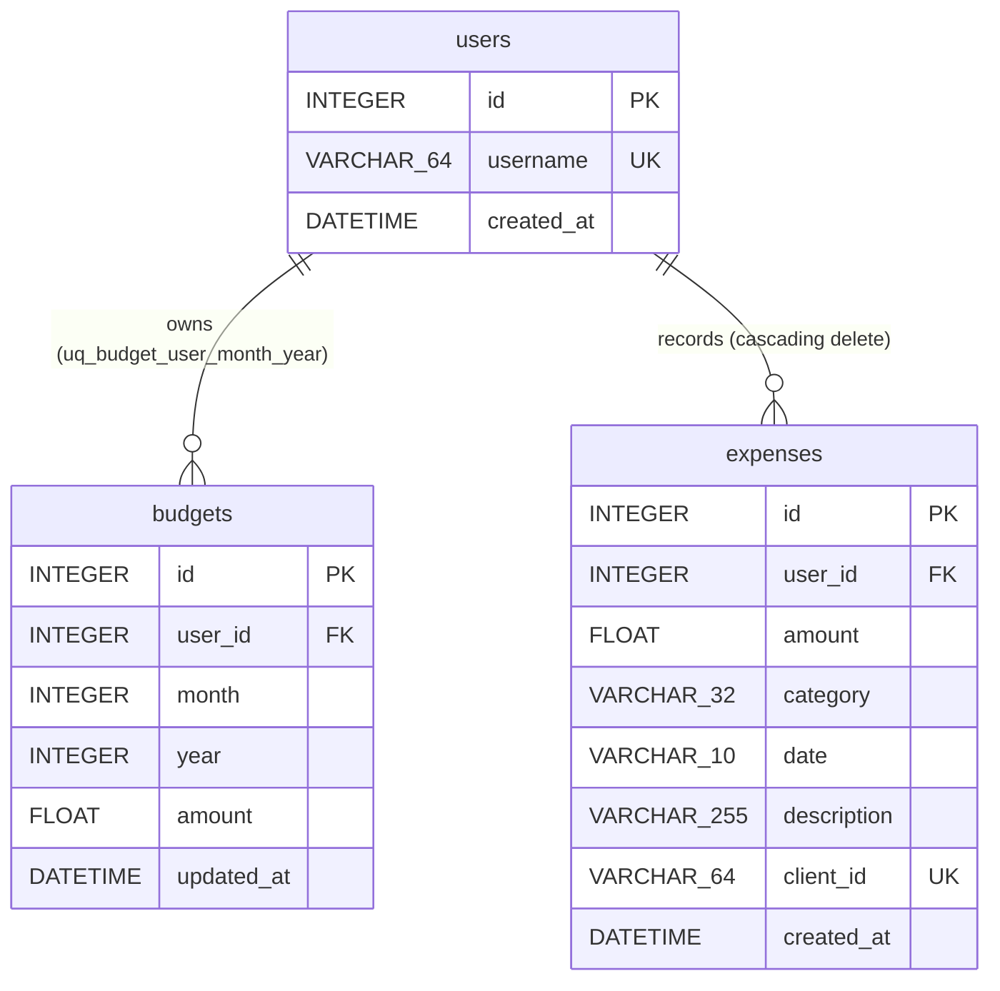

# Low-Level Design (LLD)

> Reading on GitHub Pages? Open [`lld.html`](./lld.html) • Back to [Docs Home](./README.md)

## 1. SQLite Database Schema & ER Diagram

Defined in [`backend/models.py`](../backend/models.py) using SQLAlchemy 2 ORM mappings. Every SQLite connection runs two pragmas in `_set_sqlite_pragmas`:

- `PRAGMA journal_mode=WAL;` — non-blocking concurrent reads alongside API writes
- `PRAGMA foreign_keys=ON;` — enforces `ON DELETE CASCADE` on `budgets` and `expenses`



> [!NOTE]
> `expenses.category` and `expenses.date` (`YYYY-MM-DD`) carry B-tree indexes for fast monthly prefix queries (`Expense.date.startswith("YYYY-MM-")`). Monthly budgets enforce composite uniqueness on `(user_id, month, year)`. Supported categories via `CategoryEnum` are `Food`, `Transport`, `Utilities`, `Entertainment`, `Health`, `Shopping`, and `Others`.

---

## 2. FastAPI REST Endpoints & Validation Contracts

Implemented in [`backend/main.py`](../backend/main.py) under `APIRouter(prefix="/api")` (with health probes excluded from OpenTelemetry trace spam via `excluded_urls="health,/api/health"`):

| Endpoint | Input / Query Validation | Response & Behavior |
| :--- | :--- | :--- |
| `GET /health`, `GET /api/health` | None | `{"status": "ok"}` |
| `GET /api/categories` | None | Ordered tuple of valid `CATEGORIES` |
| `GET /api/dashboard` | `month` (`1..12`), `year` (`2000..2100`), `today` (`YYYY-MM-DD`) | Monthly summary with `currency` (`INR`), `budget`, `total_expenses`, `remaining_budget`, `expenses_by_category`, `daily_trend`, `weekly_trend`, and `expenses` |
| `POST /api/expenses` | `amount` (`> 0`, `<= 100_000_000`, finite, rounded 2dp), `category`, `date`, `description` (`<= 255`), `client_id` | Returns `201 Created`; if `client_id` exists for user, returns existing expense idempotently without incrementing counters twice |
| `DELETE /api/expenses/{id}` | Path integer `expense_id` | Returns `{"deleted": true, "id": ...}`, or `404 Not Found` |
| `POST /api/budget` | `amount` (`> 0`, `<= 100_000_000`, 2dp), optional `month`, `year` | Upserts monthly budget keyed by `(user_id, month, year)` and returns `BudgetOut` |

### Sample `GET /api/dashboard` Payload

```json
{
  "month": 11,
  "year": 2026,
  "currency": "INR",
  "has_budget": true,
  "budget": 25000.0,
  "total_expenses": 1450.5,
  "remaining_budget": 23549.5,
  "categories": ["Food", "Transport", "Utilities", "Entertainment", "Health", "Shopping", "Others"],
  "expenses_by_category": [
    { "category": "Food", "total": 950.5, "count": 2 },
    { "category": "Transport", "total": 500.0, "count": 1 }
  ],
  "daily_trend": [
    { "date": "2026-11-01", "day": 1, "label": "Nov 1", "total": 0.0, "cumulative": 0.0 }
  ],
  "weekly_trend": [
    { "date": "2026-11-09", "label": "Mon", "full_label": "Nov 9", "total": 500.0 }
  ],
  "expenses": [
    { "id": 1, "amount": 950.5, "category": "Food", "date": "2026-11-08", "description": "Groceries", "client_id": "..." }
  ]
}
```

---

## 3. Aggregation Algorithms (Server & Offline Parity)

Identical calculation rules execute on the server (`get_dashboard` in [`backend/main.py`](../backend/main.py)) and in [`buildOfflineDashboard`](../frontend/src/utils/offlineStore.js) when offline:

1. **Category Breakdown (`expenses_by_category`):** Groups expenses matching `YYYY-MM-` by category, sums floats rounded to 2 decimals, and sorts descending by `total`.
2. **Daily & Cumulative Series (`daily_trend`):** Iterates days `1..daysInMonth` using `calendar.monthrange` (Python) or `PlainYearMonth.daysInMonth` (JS), tracking per-day totals alongside running `cumulative` spend.
3. **Weekly Window (`weekly_trend`, Mon–Sun):** Uses the client-supplied `today` query parameter (`Temporal.Now.plainDateISO().toString()`) so weekly boundaries match the user's device date rather than container UTC. For the current month, computes Monday via `weekday()` / `dayOfWeek - 1`; for past/future months, plots the trailing 7 days of that month.

---

## 4. Frontend Modules & Currency Design

| Module | Responsibilities & Design Highlights |
| :--- | :--- |
| [`currency.js`](../frontend/src/utils/currency.js) | Defaults `DEFAULT_CURRENCY = 'INR'` with `en-IN` number grouping (`₹25,000.00` via `Intl.NumberFormat`). Persists optional overrides (`INR`, `USD`, `EUR`, `GBP`) in `localStorage['mt_currency_code']`. |
| [`temporal.js`](../frontend/src/utils/temporal.js) | Conditionally imports `temporal-polyfill` only when `globalThis.Temporal` is unavailable. Formats month headers via `ym.toPlainDate({ day: 1 }).toLocaleString(...)` to avoid `RangeError: Mismatched calendars` on native Chrome `Temporal` (`iso8601` vs `gregory`). |
| [`offlineStore.js`](../frontend/src/utils/offlineStore.js) | Wraps IndexedDB (`money-tracker-pwa` / `kv`, with `localStorage` fallback) for period snapshots, `pending_expenses`, and `pending_budgets`. |
| [`validation.js`](../frontend/src/utils/validation.js) | Syncs `aria-invalid` using CSS `:user-invalid` with a `WeakMap` dirty/blur fallback so validation errors appear only after user interaction. |
| [`AddExpenseDialog.jsx`](../frontend/src/components/AddExpenseDialog.jsx) | Semantic `<dialog closedby="any">` launched with `showModal()`, autofocusing `Amount (INR) *` and providing pointer-bounds backdrop dismissal where native `closedBy` is unsupported. |

← Previous: [High-Level Design (HLD)](./hld.md) | Next: [Observability & LGTM Setup →](./observability.md)

