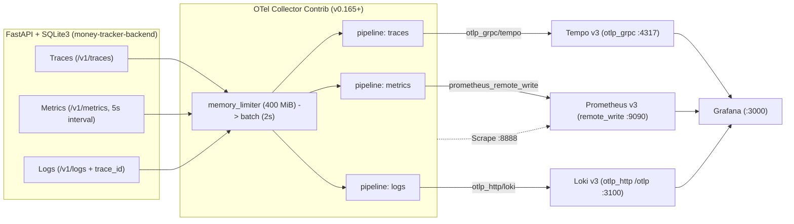

# Observability & LGTM Stack Setup

> Reading on GitHub Pages? Open [`observability.html`](./observability.html) • Back to [Docs Home](./README.md)

## 1. Telemetry Signals Pipeline

All three telemetry signals leave `money-tracker-backend` via OTLP/HTTP (`:4318`) toward `otel-collector`, keeping instrumentation completely decoupled from storage engines.



---

## 2. Backend OpenTelemetry Python SDK

Initialized in `setup_observability()` inside [`backend/main.py`](../backend/main.py) with resource attributes `service.name=money-tracker-backend`, `service.version=1.0.0`, and `service.namespace=money-tracker`.

### Automatic Instrumentors & Log Correlation
- **`FastAPIInstrumentor`:** Generates root HTTP server spans and latency histograms (`http_server_duration_milliseconds_*`, excluding `/health` and `/api/health`).
- **`SQLite3Instrumentor`:** Produces child SQL execution spans per query inside each HTTP trace.
- **`LoggingInstrumentor` + `TraceContextFilter`:** Ensures every log record includes valid `trace_id` (`032x`) and `span_id` (`016x`) formatted as:
  `%(asctime)s %(levelname)s [%(name)s] trace_id=%(otelTraceID)s span_id=%(otelSpanID)s - %(message)s`.
- **Test Isolation (`OTEL_DISABLE_EXPORTERS=true`):** Keeps `TracerProvider` active in unit tests for span assertion without making network calls to the collector.

### Custom Business Metrics

| Instrument Name | Type | Attributes / Unit | Purpose |
| :--- | :--- | :--- | :--- |
| `money_tracker_expenses_created` | Counter | `category`, unit `1` | Tracks expense creations split by category |
| `money_tracker_expense_amount` | Histogram | `category`, unit `DEFAULT_CURRENCY` (`INR`) | Tracks distribution of recorded expense amounts |
| `money_tracker_budget_updated` | Counter | unit `1` | Tracks monthly budget cap updates |
| `money_tracker_dashboard_requests` | Counter | unit `1` | Tracks dashboard query volume |

---

## 3. OpenTelemetry Collector Contrib Config

Defined in [`observability/otel-collector-config.yaml`](../observability/otel-collector-config.yaml) targeting Collector Contrib v0.165+:

```yaml
exporters:
  prometheus_remote_write:
    endpoint: "http://prometheus:9090/api/v1/write"
    resource_to_telemetry_conversion:
      enabled: true
    tls:
      insecure: true

  otlp_http/loki:
    endpoint: "http://loki:3100/otlp"
    tls:
      insecure: true

  otlp_grpc/tempo:
    endpoint: "tempo:4317"
    tls:
      insecure: true

service:
  pipelines:
    traces:
      receivers: [otlp]
      processors: [memory_limiter, batch]
      exporters: [otlp_grpc/tempo]
    metrics:
      receivers: [otlp]
      processors: [memory_limiter, batch]
      exporters: [prometheus_remote_write]
    logs:
      receivers: [otlp]
      processors: [memory_limiter, batch]
      exporters: [otlp_http/loki]
```

> [!TIP]
> `service.telemetry.metrics.readers` configures Prometheus self-metrics scraping on `0.0.0.0:8888`, replacing the deprecated legacy `address` field removed in recent Collector releases.

---

## 4. Storage Backends (Prometheus v3, Loki v3, Tempo v3)

| Backend | Configuration File & Version Notes |
| :--- | :--- |
| **Prometheus v3** | Launched in [`docker-compose.yml`](../docker-compose.yml) with `--web.enable-remote-write-receiver` and `--web.enable-otlp-receiver`. Scrapes `localhost:9090` and `otel-collector:8888` every `15s` via [`prometheus.yaml`](../observability/prometheus.yaml). |
| **Loki v3** | Native OTLP ingestion at `http://loki:3100/otlp` in [`loki-config.yaml`](../observability/loki-config.yaml). Uses `schema: v13` with `store: tsdb` (required by Loki v3 when `allow_structured_metadata: true`), indexing `service.name`, `service.namespace`, and `deployment.environment`. |
| **Tempo v3** | Simplified monolithic configuration in [`tempo.yaml`](../observability/tempo.yaml) (omits removed Tempo v2 `ingester:` and `compactor:` blocks). Accepts OTLP on `:4317`/`:4318` and writes WAL + blocks under `/var/tempo`. |

---

## 5. Grafana Provisioning & Trace Correlation

Grafana (`http://localhost:3000`, anonymous `Admin` enabled locally alongside `admin` / `admin`) mounts [`observability/grafana/provisioning/`](../observability/grafana/provisioning):

1. **Datasources ([`datasources.yaml`](../observability/grafana/provisioning/datasources/datasources.yaml)):**
   - **Prometheus (`uid: prometheus`, default):** Queries remote-written OTel metrics & counters.
   - **Loki (`uid: loki`):** Configures `derivedFields` matching both inline `trace_id=([0-9a-fA-F]+)` and the `trace_id` label, jumping directly to Tempo spans.
   - **Tempo (`uid: tempo`):** Enables `tracesToLogsV2` mapping `service.name` → `service_name` in Loki (`nodeGraph` and `lokiSearch` enabled).
2. **Pre-Loaded Dashboard ([`money-tracker.json`](../observability/grafana/provisioning/dashboards/money-tracker.json), UID `money-tracker-lgtm`):**

```promql
# Expenses created by category
sum by (category) (money_tracker_expenses_created_total)

# Backend API p95 latency by route
histogram_quantile(0.95, sum(rate(http_server_duration_milliseconds_bucket[5m])) by (le, http_route))
```

```logql
# Correlated backend logs in Loki
{service_name="money-tracker-backend"}
```

← Previous: [Low-Level Design (LLD)](./lld.md) | [Docs Home](./README.md)

